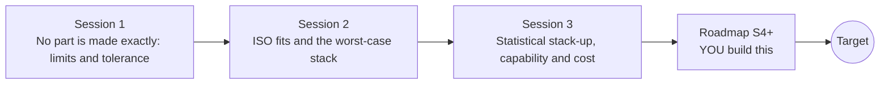

# opentolerance

[](https://github.com/KrunalPanchal1995/opentolerance/actions/workflows/ci.yml)   [](https://colab.research.google.com/github/KrunalPanchal1995/opentolerance/blob/main/sessions/session-01/lesson.ipynb) [](https://krunalpanchal1995.github.io/opentolerance/)

**Choose fits and tolerances so parts assemble and still work, in three sessions.**

opentolerance teaches how engineers allow parts to differ from their drawing: limits, ISO fits, worst-case and statistical stack-ups, using only Python and a browser.

- **Start from a pin and a hole.** Session 1 needs only subtraction; limits, tolerance and clearance are explained from scratch.
- **See it vary.** Every session ships a slider app that runs in the browser, with labelled graphs.
- **Know you got it right.** Each session ends with a checkpoint that prints PASS or FAIL against hand calculations, exact corner enumeration and simulation.
- **Build the missing half.** The repo stops at Session 3 on purpose; the roadmap shows the path to the Target.

[Target](#the-target) · [Who is this for](#who-is-this-for) · [Quick start](#quick-start) · [Sessions](#sessions) · [Roadmap](#roadmap) · [Contribute](#contribute) · [Explainer PDF](docs/explainer.pdf)

> **This repo is incomplete on purpose.** Sessions 1 to 3 are here and fully working. The finished Target below is a preview of what the community can build next. We show you the path, not the code. Sessions 4 and up are yours.

## The Target

An animated pin drops into a hole while the part sizes vary at random. Beside it a histogram of assembly gaps fills in, one build at a time, between the red limit lines, and a bar chart compares the worst-case tolerance (the sum) with the statistical one (the root-sum-square). Your goal over the coming sessions: build that simulator yourself, then add drifting processes and standard tolerance grades.


*Target: a pin enters a hole with random part sizes while the gap histogram fills in and worst case is compared with statistical stack-up*


*Target still: the gap histogram between its limits and the two ways of adding tolerances*


*The same stack when the process centre drifts: a design that looks safe starts to fail*

Try it live:

- [Math Visual Studio: probability distributions (Atlas S25)](https://krunalpanchal1995.github.io/studio/#atlas?ch=S25&ex=1)
- [Math Visual Studio: uncertainty quantification (Atlas S27)](https://krunalpanchal1995.github.io/studio/#atlas?ch=S27&ex=1)

How the Target was made is shown only as a path in [promo/roadmap.md](promo/roadmap.md).

## Who is this for
**diploma / undergraduate to advanced undergraduate (levels 5-6).** Topic area: Mechanical Engineering.

Prerequisites:

- Arithmetic with decimals and the idea of a plus-or-minus value.
- Python 3.10 or newer; if `python --version` works, you are ready. PRIMER.md explains the rest.
- Session 3 uses the bell-shaped normal distribution; it is explained from scratch. No prior GitHub or manufacturing experience is needed.

New to Python? Read [PRIMER.md](PRIMER.md) first (10 minutes).

## Quick start

No installation knowledge needed. You need [Git](https://git-scm.com/downloads) and [Python 3.10+](https://www.python.org/downloads/) (Windows: tick "Add Python to PATH"). On Mac and Linux type `python3` wherever this page says `python`.

```bash
git clone https://github.com/KrunalPanchal1995/opentolerance.git
cd opentolerance
python start.py 1
```

`start.py` creates a private environment, installs what is needed and runs Session 1 with its checkpoint. Next: `python start.py 2`, `python start.py 3`, or `python start.py test` to check everything. Only a checkpoint: `python start.py check 1`.

Four lines turn the idea of Session 3 into a result (they work as they are): Save it as `try.py` and run it with `python start.py run try.py` (this uses the private environment, where NumPy is installed):

```python
import numpy as np
rng = np.random.default_rng(1)
t = np.full(5, 0.10)                      # five parts, each +-0.10 mm (3 sigma)
gap = rng.normal(0.0, t / 3, (200000, 5)).sum(axis=1)   # random errors add up
print(round(float(3 * gap.std()), 3), 'mm statistical; worst case would be', t.sum())
```

Every session also opens in your browser with sliders (no install): [live apps](https://krunalpanchal1995.github.io/opentolerance/). Or use the Colab badge above for the notebook.

## Sessions

| # | Session | Model level | Time | Live app |
|---|---|---|---|---|
| 1 | [No part is made exactly: limits and tolerance](sessions/session-01/README.md) | Level 1: conceptual interactive model | 60 min | [open](https://krunalpanchal1995.github.io/opentolerance/session-01/) |
| 2 | [ISO fits and the worst-case stack](sessions/session-02/README.md) | Level 2: mathematical engineering model | 75 min | [open](https://krunalpanchal1995.github.io/opentolerance/session-02/) |
| 3 | [Statistical stack-up, capability and cost](sessions/session-03/README.md) | Level 3: simulation and validation | 90 min | [open](https://krunalpanchal1995.github.io/opentolerance/session-03/) |

Each session follows the same six steps: A real-world problem, B concept and theory, C visual explanation, D interactive simulation, E worked example and experiment, F assessment and design challenge. Each ends with `checkpoint.py`, which prints `PASS` or `FAIL` against reference numbers. Session 3 also contains the real-world mini-project: **Allocate tolerances to a five-part assembly at minimum cost**.

## Architecture



| Folder or file | What is inside |
|---|---|
| `sessions/` | three sessions: README (A-F), `lesson.py`, notebook, live app, exercises, activity sheet, checkpoint |
| `promo/` | the Target: media, live links, and the roadmap (path only) |
| `docs/` | `explainer.tex` and the built `explainer.pdf` |
| `tests/` | runs every lesson and checkpoint headless |
| `start.py` | one command to set up and run anything |
| `QUALITY.md`, `RUBRIC.md` | the quality checklist and the scoring rubric |
| `.github/` | CI, PDF build, Pages deploy, issue and PR templates |

## Roadmap

| Milestone | What you will build | Difficulty |
|---|---|---|
| Session 4: Parts that are not normal | A stack simulator that draws each part from a normal, a uniform or a skewed distribution. | intermediate |
| Session 5: Watch for drift with a control chart | A control chart with three-sigma limits on subgroups of five, driven by a slowly drifting simulated process. | intermediate |
| Session 6: Allocate with standard IT grades | An allocator that picks an IT grade for each part from a table and minimises the illustrative cost. | advanced |
| Session 7: Design that survives drift | A design search that adds a drift allowance and reports the cheapest allocation that still passes. | advanced |
| Session 8: Stacks in two dimensions | A stack where one part is tilted, with each tolerance weighted by the sine or cosine of its angle. | advanced |

Full detail with a checkpoint per milestone: [promo/roadmap.md](promo/roadmap.md).

## Contribute
New to GitHub? Read [CONTRIBUTING.md](CONTRIBUTING.md); it starts from zero. Pick an issue labelled `good first issue`. Translations into Hindi, Telugu, Tamil and Malayalam are welcome.

<details>
<summary>Development</summary>

```bash
python start.py test        # runs every lesson and checkpoint
```
Lessons use `# %%` cell markers so they open as notebooks in VS Code. See [QUALITY.md](QUALITY.md) for the standard every session meets.
</details>

## License
MIT. See [LICENSE](LICENSE). Media in `promo/media` is (c) Krunal Panchal, CC BY 4.0.

## Acknowledgments
Part of the [PAN IIT OSS](https://hellofoss.tech-iitb.org/projects) open-source teaching collection, modelled on the structure of [openspline](https://github.com/openspline/openspline). Built on ideas from the Math Visual Studio at https://krunalpanchal1995.github.io/studio/.
