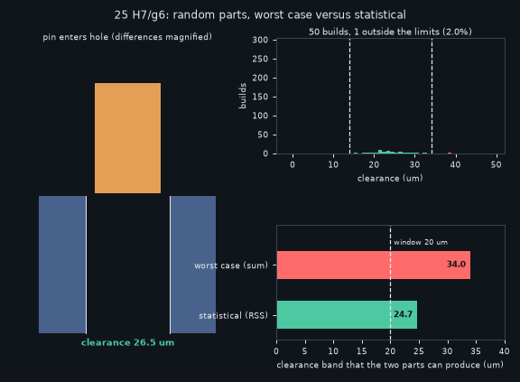
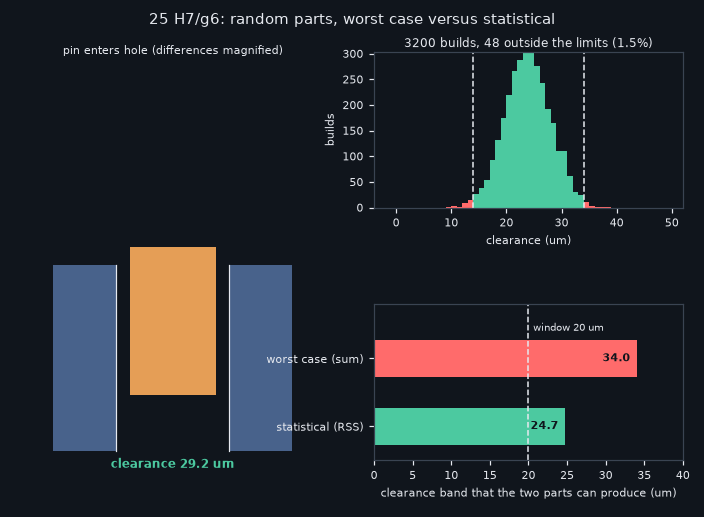
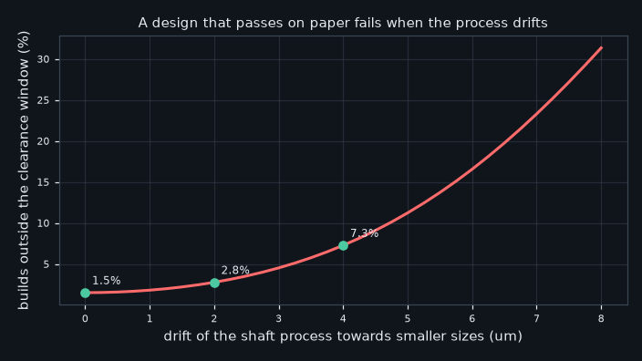

# What you are building toward

An animated pin drops into a hole while the part sizes vary at random. Beside it a histogram of assembly gaps fills in, one build at a time, between the red limit lines, and a bar chart compares the worst-case tolerance (the sum) with the statistical one (the root-sum-square). Your goal over the coming sessions: build that simulator yourself, then add drifting processes and standard tolerance grades.

*Target: a pin enters a hole with random part sizes while the gap histogram fills in and worst case is compared with statistical stack-up*

*Target still: the gap histogram between its limits and the two ways of adding tolerances*

*The same stack when the process centre drifts: a design that looks safe starts to fail*

These results come from a private reference build. The code is not published; the roadmap shows the path so you can build your own.

Live links:

- [Math Visual Studio: probability distributions (Atlas S25)](https://krunalpanchal1995.github.io/studio/#atlas?ch=S25&ex=1)
- [Math Visual Studio: uncertainty quantification (Atlas S27)](https://krunalpanchal1995.github.io/studio/#atlas?ch=S27&ex=1)
