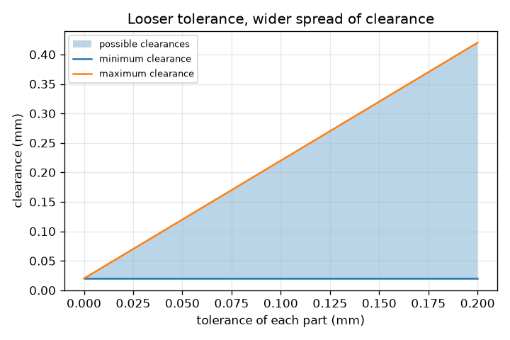
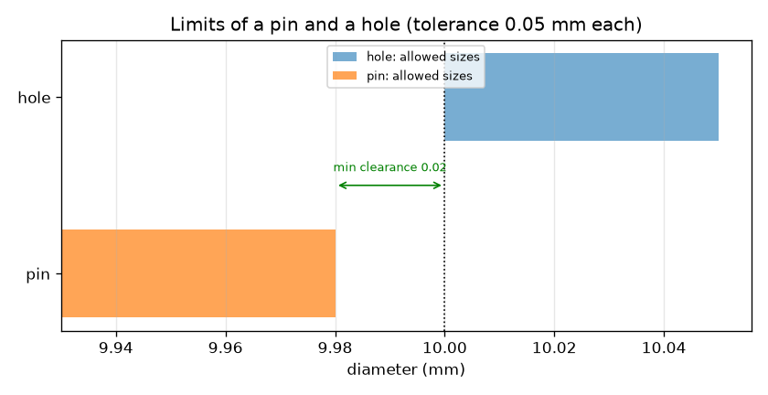

# Session 1: No part is made exactly: limits and tolerance

*Level 1 (conceptual interactive model) · about 60 minutes · opentolerance*

> This is a simplified educational model. It is not a validated design tool and must not be used for real structures, electrical installations, vehicles, industrial processes or medical decisions.

**Prerequisites**

- Subtracting decimals (for example 10.05 - 9.98).
- You have read PRIMER.md and run `python start.py 1` once.

**Learning objectives.** After this session you can:

- Explain why every dimension on a drawing needs a tolerance.
- Write the upper and lower limits of a part and compute its tolerance.
- Compute the clearance between a hole and a pin and tell clearance from interference.
- Find the smallest and largest clearance for parts made anywhere inside their limits.

## A. Real-world problem
A shaft that is a little too big will not go into a hole that is a little too small. A machine cannot cut a hole to exactly 10.000 mm: tools wear, metal warms up, measuring has its own error. So the drawing does not say 'make it 10 mm'; it says 'make it between these two sizes'. How wide may that range be so that every pin still goes into every hole, and how much does a narrower range cost? Today we only ask the first half.

## B. Concept and theory
A part has an upper limit (the largest size allowed) and a lower limit (the smallest). The tolerance is the difference between them: the total wiggle we accept. A measured part is in tolerance if its size lies between the limits, and a size exactly on a limit is still acceptable. A pin goes into a hole if the hole is bigger than the pin. The clearance is the hole size minus the pin size. If the clearance is positive it is a clearance; if negative it is called interference (the pin is bigger than the hole); zero is line to line. When both parts may be anywhere inside their limits, the smallest clearance occurs with the biggest pin in the smallest hole and the largest clearance with the smallest pin in the biggest hole. In this session the pin is specified between 9.98 - tol and 9.98 mm and the hole between 10.00 and 10.00 + tol mm, where tol is the tolerance of each part.

| Symbol | Meaning | Unit |
|---|---|---|
| upper, lower | upper and lower limits of a part | mm |
| tol | tolerance = upper limit - lower limit | mm |
| c | clearance = hole size - pin size | mm |
| c_min, c_max | smallest and largest clearance over all allowed parts | mm |

**Assumptions**

- Sizes are diameters at the same temperature, with perfectly round parts and no surface roughness.
- The pin and the hole may be anywhere inside their limits.
- Only diameters are considered (no shape or position errors).

$$ t = U - L $$

$$ c = d_{\mathrm{hole}} - d_{\mathrm{pin}} $$

$$ c_{\min} = L_{\mathrm{hole}} - U_{\mathrm{pin}},\qquad c_{\max} = U_{\mathrm{hole}} - L_{\mathrm{pin}} $$

## C. Visual explanation
The first figure draws the allowed sizes of the pin (orange) and the hole (blue) as two bars on a diameter scale for a tolerance of 0.05 mm each. The gap between the right end of the orange bar and the left end of the blue bar is the smallest clearance, 0.02 mm. The second figure plots the possible clearances against the tolerance: the lower line stays at 0.02 mm while the upper line rises, so the band of possible clearances widens as the tolerance is loosened.

*The band of possible clearances widens as the tolerance of each part grows.*

*Allowed sizes of the pin and the hole for a tolerance of 0.05 mm each; the arrow marks the smallest clearance.*

## D. Interactive simulation
Run the lesson (`python start.py 1`), then open the live app: [Session 1: a pin and a hole](https://krunalpanchal1995.github.io/opentolerance/session-01/) (or `app.html` in this folder). Move the pin and hole sliders and watch the clearance and the picture (the size differences are magnified), then change the tolerance and see the band of possible clearances in the graph view.

**Challenge.** Choose a pin and a hole, both inside their limits, whose clearance is between 0.08 and 0.10 mm.

## E. Worked example and experiment
**Problem.** With a tolerance of 0.05 mm on both parts, find the limits of the pin and of the hole, the smallest and largest clearance, and decide whether a pin measured at 9.99 mm is acceptable.

1. Pin limits: upper 9.98 mm, lower 9.98 - 0.05 = 9.93 mm. Hole limits: lower 10.00 mm, upper 10.00 + 0.05 = 10.05 mm.
2. Tolerance of the pin = 9.98 - 9.93 = 0.05 mm, of the hole = 10.05 - 10.00 = 0.05 mm.
3. Smallest clearance = hole lower limit - pin upper limit = 10.00 - 9.98 = 0.02 mm.
4. Largest clearance = hole upper limit - pin lower limit = 10.05 - 9.93 = 0.12 mm.
5. A pin of 9.99 mm is above the upper limit 9.98 mm, so it is out of tolerance and is rejected, although it would still fit a 10.00 mm hole with 0.01 mm to spare. The drawing, not the single fit, decides.

**Answer.** Clearance 0.02 to 0.12 mm for every allowed pin and hole; the 9.99 mm pin is rejected.

**Experiment.** Measure the diameter of five drill bits (or bolts) of the same nominal size with a vernier caliper that reads to 0.02 mm, and check how much they differ; then try each in a hole drilled with a single bit. Compare the spread you see with the tolerance you would be willing to put on a drawing. The model assumes exact measurement and perfect roundness; a caliper has its own error of a few hundredths of a millimetre, and real parts are slightly oval, so the real fit is a little tighter than the model.

## F. Assessment and design challenge
**Question type A: Conceptual.** Why does a drawing give limits instead of one exact size? What does a part whose size is exactly on the upper limit count as?

Hint

Think about what a machine can and cannot hold, and read the definition of 'in tolerance'.

Step-by-step solution

No process produces an exact size every time (tool wear, temperature, measurement error), so the drawing states how far from the ideal the size may be. The limits are the largest and smallest acceptable sizes. A part exactly on a limit is still in tolerance, because the limits themselves are allowed.

**Question type B: Numerical.** A pin is made between 9.93 and 9.98 mm and a hole between 10.00 and 10.05 mm. A 9.95 mm pin meets a 10.04 mm hole. What is the clearance, and are both parts in tolerance? Sanity check it against the clearance range 0.02 to 0.12 mm.

Hint

clearance = hole - pin; then compare each size with its limits.

Step-by-step solution

Clearance = 10.04 - 9.95 = 0.09 mm. The pin is between 9.93 and 9.98 and the hole between 10.00 and 10.05, so both are in tolerance. The value 0.09 mm lies between the smallest (0.02 mm) and largest (0.12 mm) clearance, as it must.

**Question type C: Graph and simulation interpretation.** In the graph of clearance against tolerance, why does the lower line stay at 0.02 mm while the upper line rises? What is the largest clearance at a tolerance of 0.10 mm?

Hint

Which limits does the smallest clearance use, and do they move when tol changes?

Step-by-step solution

The smallest clearance uses the hole lower limit (10.00) and the pin upper limit (9.98); neither depends on tol, so it stays at 0.02 mm. The largest uses the hole upper limit and the pin lower limit, and both move outwards by tol, so it equals 0.02 + 2 tol. At tol = 0.10 mm it is 0.02 + 0.20 = 0.22 mm.

**Question type D: Design and optimisation challenge.** Design: a toy needs the pin to be loose enough to always go in but not wobble more than 0.10 mm. Choose the largest whole hundredth of a millimetre for the tolerance of each part and justify it. What do you lose by choosing a smaller one?

Hint

Set the largest clearance 0.02 + 2 tol to at most 0.10 mm.

Step-by-step solution

0.02 + 2 tol <= 0.10 gives tol <= 0.04 mm. At tol = 0.04 the clearance range is 0.02 to 0.10 mm: always assembles and never exceeds the wobble limit. A smaller tolerance (for example 0.02 mm, clearance 0.02 to 0.06 mm) also works but parts must be made more accurately, which costs more; that trade-off returns in Session 3.

Score yourself with [RUBRIC.md](../../RUBRIC.md). Print the [activity sheet](activity_sheet.md) to work on paper.

## Common misconceptions
| Common misconception | What is actually true |
|---|---|
| A part must be exactly the size on the drawing. | No part is; the drawing gives limits and the part is good anywhere between them. |
| A bigger tolerance means a better part. | A bigger tolerance means a looser requirement: easier to make and cheaper, but with a wider spread of fits. |
| If a part would still fit, it is acceptable. | Acceptance is decided by the limits on the drawing; a 9.99 mm pin may fit but is out of tolerance. |
| Interference means the parts are broken. | Interference means the pin is bigger than the hole; for a press fit that is deliberate. |

## Glossary
- **tolerance**: the total allowed variation of a size: upper limit minus lower limit
- **limit**: the largest (upper) or smallest (lower) size a part may have
- **clearance**: hole size minus pin size when positive: the space between them
- **interference**: negative clearance: the pin is bigger than the hole
- **nominal size**: the ideal size we name, such as 10 mm, before limits are applied

## Finish
1. Do the three coding tasks in [exercises.md](exercises.md).
2. Run `python start.py 1` again after your changes. It ends with the checkpoint; when it prints `PASS`, you are done. (Checkpoint only: `python start.py check 1`.)

Next: [Session 2](../session-02/README.md)
