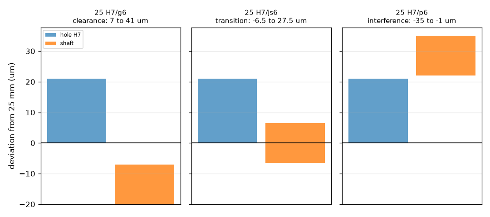
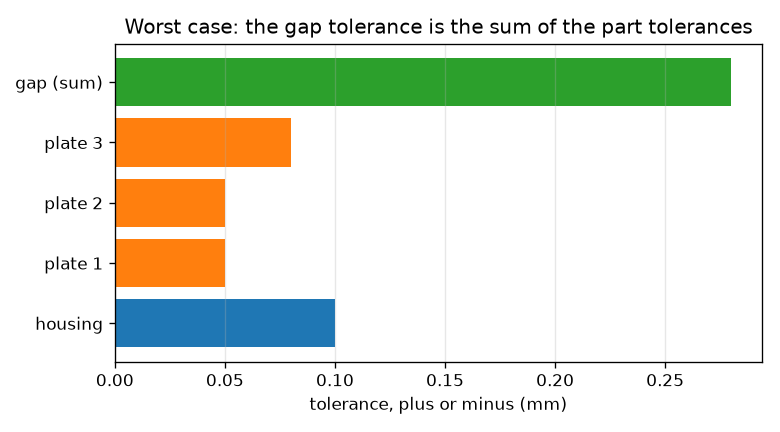

# Session 2: ISO fits and the worst-case stack

*Level 2 (mathematical engineering model) · about 75 minutes · opentolerance*

> This is a simplified educational model. It is not a validated design tool and must not be used for real structures, electrical installations, vehicles, industrial processes or medical decisions.

**Prerequisites**

- Session 1: limits, tolerance and clearance.
- Micrometres: 1 micrometre (um) = 0.001 mm.

**Learning objectives.** After this session you can:

- Decode a fit such as 25 H7/g6 into tolerance zones for the hole and the shaft.
- Compute the minimum and maximum clearance of a fit and classify it as clearance, transition or interference.
- Choose a fit for a sliding bearing and for a press fit from stated requirements.
- Add tolerances along a chain of parts (worst-case stack-up) and verify it by trying every corner.

## A. Real-world problem
A 25 mm shaft must turn freely in a bearing bore, but a gear must stay fixed on another 25 mm shaft. Both are 'a shaft in a hole'; only the fit differs. Engineers everywhere describe fits with a short code such as 25 H7/g6. What do the letters and numbers mean, how much clearance does such a fit really have, and how do the tolerances of several parts in a row add up to the gap at the end?

## B. Concept and theory
In the ISO hole-basis system the hole is always H: its zone starts at the nominal size (lower deviation EI = 0) and extends upward by the tolerance, so a hole H7 spans 0 to +IT7. The number is the tolerance grade IT: for nominal sizes over 18 up to 30 mm, IT6 = 13 um and IT7 = 21 um. The shaft letter places the shaft zone relative to the nominal size through its fundamental deviation. For this size range we use g: upper deviation es = -7 um; h: es = 0; p: lower deviation ei = +22 um; js: symmetric, plus or minus half the grade. The shaft zone has width IT, so g6 spans -20 to -7 um. The smallest clearance is the smallest hole minus the largest shaft: EI - es. The largest is the largest hole minus the smallest shaft: ES - ei. If the smallest is not negative the fit is a clearance fit; if the largest is not positive it is an interference fit; otherwise it is a transition fit. For a chain of parts, the gap is the signed sum of the lengths. In the worst case every part sits at its limit in the direction that hurts, so the gap tolerance is the sum of the part tolerances. The table values are those we state for 18 to 30 mm; check them against your copy of ISO 286 before real design work.

| Symbol | Meaning | Unit |
|---|---|---|
| IT6, IT7 | international tolerance grades, size range 18 to 30 mm | um |
| EI, ES | lower and upper deviation of the hole | um |
| ei, es | lower and upper deviation of the shaft | um |
| c_min, c_max | smallest and largest clearance | um |
| s_i | sign of part i in the chain (+1 adds to the gap, -1 subtracts) | no unit |
| x_i, t_i | nominal size and tolerance (plus or minus) of part i | mm |

**Assumptions**

- Hole-basis system, nominal sizes over 18 up to 30 mm only.
- Values are those quoted in this lesson; confirm them in the standard before use.
- Parts are at the same temperature; form and position errors are ignored.
- In the stack, every part tolerance is symmetric (plus or minus t) and the dimensions lie on one line.

$$ c_{\min} = EI - es,\qquad c_{\max} = ES - ei $$

$$ c_{\max} - c_{\min} = IT_{\mathrm{hole}} + IT_{\mathrm{shaft}} $$

$$ g = \sum_i s_i x_i,\qquad t_g^{\mathrm{WC}} = \sum_i t_i $$

## C. Visual explanation
The first figure shows tolerance zones for three fits of a 25 mm shaft in an H7 hole. The hole zone (blue) is the same in each panel, from 0 to +21 um. For g6 the shaft zone (orange) lies wholly below the hole zone: clearance. For js6 it straddles zero and overlaps the hole zone: transition. For p6 it lies wholly above: interference. The second figure is a bar chart of the part tolerances in a four-part stack and, below them, their sum, the worst-case gap tolerance.

*Tolerance zones of three fits of a 25 mm shaft in an H7 hole: clearance (g6), transition (js6) and interference (p6).*

*In a worst-case stack the gap tolerance is the sum of the part tolerances.*

## D. Interactive simulation
Run the lesson (`python start.py 2`), then open the live app: [Session 2: tolerance zones of a fit](https://krunalpanchal1995.github.io/opentolerance/session-02/) (or `app.html` in this folder). Slide the shaft upper deviation es from negative to positive and watch the shaft zone cross the hole zone; read how the minimum and maximum clearance and the fit class change, then use the graph view to see the two clearance lines against es.

**Challenge.** Choose tolerances and a shaft position for a sliding bearing: minimum clearance at least 5 um and maximum at most 45 um.

## E. Worked example and experiment
**Problem.** Compute the limits and the clearance of the fit 25 H7/g6, then the worst-case gap of a four-part stack: a housing of 40.00 +-0.10 mm holding three plates of 10.00 +-0.05, 12.00 +-0.05 and 15.00 +-0.08 mm.

1. Hole H7: EI = 0, ES = +21 um, so the hole is 25.000 to 25.021 mm.
2. Shaft g6: es = -7 um and the width is IT6 = 13 um, so ei = -7 - 13 = -20 um; the shaft is 24.980 to 24.993 mm.
3. Smallest clearance = EI - es = 0 - (-7) = 7 um (0.007 mm = 25.000 - 24.993). Largest = ES - ei = 21 - (-20) = 41 um (0.041 mm = 25.021 - 24.980).
4. The minimum is not negative, so 25 H7/g6 is a clearance fit. Check: 41 - 7 = 34 um = IT7 + IT6 = 21 + 13.
5. Stack: nominal gap = 40.00 - 10.00 - 12.00 - 15.00 = 3.00 mm. Worst-case tolerance = 0.10 + 0.05 + 0.05 + 0.08 = 0.28 mm, so the gap lies between 2.72 and 3.28 mm. Trying all 16 corners gives the same two values.

**Answer.** 25 H7/g6 has a clearance of 7 to 41 um; the stack gap is 3.00 mm with worst-case limits 2.72 and 3.28 mm.

**Experiment.** Take a plain 8 mm or 10 mm bolt and try it in holes drilled with a drill bit and then reamed: measure the play with a feeler gauge or by seeing whether it turns freely. Compare with the clearance the fit code predicts for that size. Differences come from the model's perfect geometry, temperature (parts warm up when handled), surface roughness that is lost when parts wear in, and measurement error; real fits also change after assembly because of burrs and lubricant.

## F. Assessment and design challenge
**Question type A: Conceptual.** Why is a fit with minimum clearance 0 (such as H7/h6) still called a clearance fit, and what separates a transition fit from an interference fit?

Hint

Look at the classification rule: which clearance limit must be non-negative or non-positive?

Step-by-step solution

A clearance fit is one where the minimum clearance is not negative, so no pair can interfere; for H7/h6 the minimum is exactly 0 and the largest shaft just equals the smallest hole. In an interference fit the maximum clearance is not positive, so every pair has interference. In a transition fit the minimum is negative and the maximum positive, so some pairs have clearance and others interference.

**Question type B: Numerical.** Find the smallest and largest clearance of 25 H7/h6, using IT6 = 13 um, IT7 = 21 um and es = 0 for h. Sanity check: what must their difference be?

Hint

h6 spans -13 to 0 um. Apply EI - es and ES - ei.

Step-by-step solution

Shaft h6: es = 0, ei = -13 um. Minimum = EI - es = 0 - 0 = 0 um. Maximum = ES - ei = 21 - (-13) = 34 um. The difference 34 um equals IT7 + IT6 = 21 + 13, as it must.

**Question type C: Graph and simulation interpretation.** In the zone figure, how far above the top of the H7 hole zone does the p6 shaft zone start? What does that mean for assembly?

Hint

The hole zone ends at +21 um; the p6 zone starts at its lower deviation.

Step-by-step solution

The p6 zone starts at +22 um, which is 1 um above the top of the hole zone (+21 um). Even the smallest shaft is 1 um bigger than the largest hole, so every pair has interference (1 to 35 um): a light press fit that needs force or heating to assemble.

**Question type D: Design and optimisation challenge.** Design: select a fit from H7/g6, H7/h6, H7/js6 and H7/p6 for (a) a sliding bearing that needs at least 5 um and at most 45 um of clearance and (b) a gear that must stay on its shaft with interference in every build and at most 40 um of it. Give the clearance limits that justify your choice, and say what is wrong with the others.

Hint

Compute the minimum and maximum clearance of each fit; then test them against the requirements.

Step-by-step solution

H7/g6: 7 to 41 um, H7/h6: 0 to 34 um, H7/js6: -6.5 to +27.5 um, H7/p6: -35 to -1 um. (a) Only g6 satisfies 5 to 45 um; h6 can have 0 um (no oil film) and js6 can interfere. (b) Only p6 has interference in every build (1 to 35 um, within 40 um); h6 and g6 never interfere and js6 only sometimes. Assumption: the requirements are illustrative; real press fits also check hole stress and torque.

Score yourself with [RUBRIC.md](../../RUBRIC.md). Print the [activity sheet](activity_sheet.md) to work on paper.

## Common misconceptions
| Common misconception | What is actually true |
|---|---|
| A higher IT number means a tighter tolerance. | A higher grade number is a looser (larger) tolerance: IT7 is 21 um but IT6 is 13 um for the same size range. |
| The tolerance of a fit is the tolerance of the shaft. | The spread of clearance is the sum of the hole and shaft tolerances (21 + 13 = 34 um here). |
| Tolerances in a chain average out, so the gap tolerance is the biggest of the part tolerances. | In the worst case they add: 0.28 mm for the example stack; averaging is the statistical idea in Session 3. |
| The fit code gives sizes directly. | The code gives zones relative to the nominal size, using tables that depend on the size range; look up the table for your size. |

## Glossary
- **fit**: the relationship between a hole and a shaft that go together, from loose to tight
- **hole-basis system**: the hole is always H (lower deviation zero) and the fit is set by the shaft letter
- **IT grade**: international tolerance grade: a standard width of tolerance zone that depends on size
- **fundamental deviation**: the distance from the nominal size to the nearer edge of the tolerance zone
- **worst-case stack-up**: adding all the part tolerances so the gap is safe even if every part is at its worst limit

## Finish
1. Do the three coding tasks in [exercises.md](exercises.md).
2. Run `python start.py 2` again after your changes. It ends with the checkpoint; when it prints `PASS`, you are done. (Checkpoint only: `python start.py check 2`.)

Next: [Session 3](../session-03/README.md)
