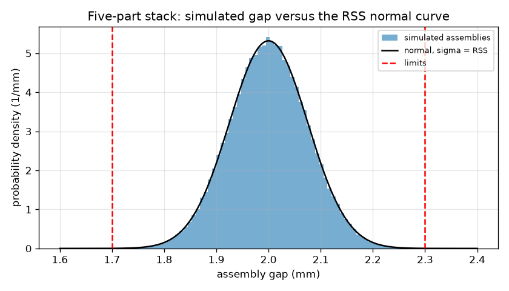
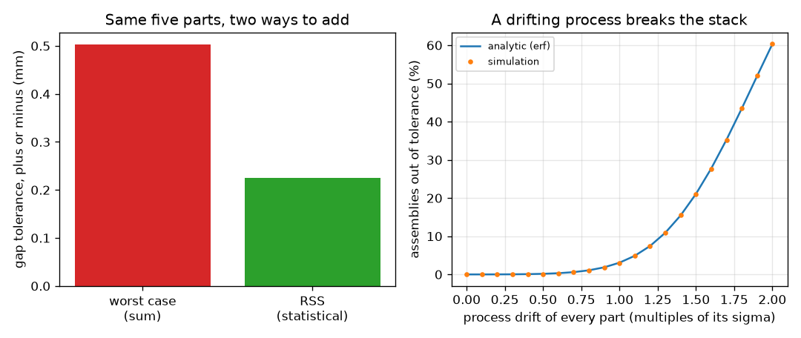

# Session 3: Statistical stack-up, capability and cost

*Level 3 (simulation and validation) · about 90 minutes · opentolerance*

> This is a simplified educational model. It is not a validated design tool and must not be used for real structures, electrical installations, vehicles, industrial processes or medical decisions.

**Prerequisites**

- Session 2: worst-case stack-up.
- Session 1 and 2 ideas of tolerance and clearance.
- A feel for the bell-shaped normal distribution (explained in Section B).

**Learning objectives.** After this session you can:

- Combine independent part tolerances by root-sum-square and compare with the worst-case sum.
- Compute Cp, Cpk and the fraction of assemblies out of tolerance, and verify them by Monte Carlo simulation and exact corner enumeration.
- Show how a drifting process centre breaks a stack that looks safe, and quantify it.
- Allocate tolerances to five parts at minimum illustrative cost while meeting a capability target.

## A. Real-world problem
Worst-case stack-up is safe but expensive: it makes every part so accurate that it assumes all of them can be at their worst limit in the same assembly. With five independent parts that is very unlikely. Statistical tolerancing accepts a tiny, calculated fraction of out-of-tolerance assemblies in exchange for looser, cheaper parts. But what if the machine drifts? Can a design that passes on paper fail a few percent of builds? And given the cost of each part, how should the tolerance be shared out?

## B. Concept and theory
We take a part tolerance t as plus or minus three standard deviations of the process (sigma = t / 3), so that about 99.7 percent of that part is inside its tolerance. For independent parts, variances add, so the gap has sigma_gap = sqrt(sum of sigma_i squared) and a plus or minus three sigma tolerance of sqrt(sum of t_i squared): the root-sum-square, RSS. It is never larger than the worst-case sum. With specification limits LSL and USL, the capability index is Cp = (USL - LSL) / (6 sigma), and Cpk = min(USL - mu, mu - LSL) / (3 sigma) also penalises a mean mu that is off-centre. A common guideline is Cp of at least 1.33, which puts the limits four sigma from the centre. For a normal distribution, the fraction outside the limits is Phi((LSL - mu)/sigma) + 1 - Phi((USL - mu)/sigma), where Phi(z) = (1 + erf(z / sqrt 2)) / 2. In the illustrative cost model the cost of part i is k_i / t_i, so halving the tolerance doubles the cost; minimising the total cost for a given RSS gap tolerance (Lagrange multipliers) gives t_i proportional to the cube root of k_i. All of this is a simplified model: real parts may be skewed or correlated, and real cost curves differ.

| Symbol | Meaning | Unit |
|---|---|---|
| t_i | tolerance (plus or minus) of part i, taken as 3 sigma | mm |
| sigma_i, sigma_gap | standard deviation of part i and of the gap | mm |
| LSL, USL | lower and upper specification limits of the gap | mm |
| mu | mean of the gap | mm |
| Cp, Cpk | process capability indices | no unit |
| k_i | illustrative cost coefficient of part i (cost = k_i / t_i) | cost unit x mm |
| drift | shift of every process centre, in multiples of its own sigma | no unit |

**Assumptions**

- Part sizes are independent and normally distributed with sigma = t / 3.
- The gap is a straight sum of the part sizes (one-dimensional stack).
- The cost model k / t is illustrative, not data from a factory.
- Educational model only: not a validated design tool for safety-critical parts.

$$ \sigma_i = \frac{t_i}{3},\qquad \sigma_{\mathrm{gap}} = \sqrt{\sum_i \sigma_i^2},\qquad t_{\mathrm{RSS}} = \sqrt{\sum_i t_i^2} $$

$$ C_p = \frac{USL - LSL}{6\sigma},\qquad C_{pk} = \frac{\min(USL-\mu,\ \mu-LSL)}{3\sigma} $$

$$ P_{\mathrm{out}} = \Phi\!\left(\frac{LSL-\mu}{\sigma}\right) + 1 - \Phi\!\left(\frac{USL-\mu}{\sigma}\right),\qquad \Phi(z) = \tfrac12\left(1+\mathrm{erf}\frac{z}{\sqrt2}\right) $$

$$ \min \sum_i \frac{k_i}{t_i}\ \text{ with }\ \sum_i t_i^2 = T^2 \ \Rightarrow\ t_i \propto k_i^{1/3} $$

## C. Visual explanation
The first figure is a histogram of 200000 simulated assemblies of the five-part stack (gap nominal 2.00 mm, limits 1.70 to 2.30 mm) with the normal curve of the RSS sigma on top: the bars follow the curve, and the limits lie four sigma out. The second figure has two panels. The left bars compare the worst-case tolerance (0.503 mm for the equal allocation) with the RSS one (0.225 mm). The right plot shows the percentage of assemblies out of tolerance as every process centre drifts, by erf (line) and by simulation (dots): flat and tiny near zero drift, then climbing steeply.

*200000 simulated five-part assemblies: the histogram follows the RSS normal curve, with limits four sigma away.*

*Left: worst-case and RSS tolerance for the same parts. Right: percentage out of tolerance as the process drifts, by erf and by simulation.*

## D. Interactive simulation
Run the lesson (`python start.py 3`), then open the live app: [Session 3: worst case versus statistical](https://krunalpanchal1995.github.io/opentolerance/session-03/) (or `app.html` in this folder). Set the common part tolerance and the drift of the process centre; watch the bell curve move and widen against the two red limits, compare the worst-case and RSS bars, and read Cp, Cpk and the percentage out in the readout.

**Challenge.** With the processes drifted by at least 0.5 sigma, keep Cpk at least 1.0 while every part tolerance stays at least 0.08 mm.

## E. Worked example and experiment
**Problem.** Five independent parts each have a tolerance of +-0.10 mm and the gap must stay within 2.00 +-0.30 mm. Find the worst-case and RSS gap tolerances, sigma, Cp and the fraction out of tolerance for a centred process.

1. Worst case: 5 x 0.10 = 0.500 mm. That is far outside +-0.30 mm, so a worst-case design would fail the requirement.
2. RSS: sqrt(5 x 0.10^2) = 0.10 x sqrt 5 = 0.224 mm (0.2236). This is inside +-0.30 mm.
3. Sigma of the gap = 0.2236 / 3 = 0.0745 mm.
4. Cp = (2.30 - 1.70) / (6 x 0.0745) = 0.60 / 0.447 = 1.34, just above the 1.33 guideline.
5. The limits are 0.30 / 0.0745 = 4.02 sigma away, so the fraction out is 2 x Phi(-4.02) = 5.7e-5, that is 0.0057 percent, about 1 assembly in 17500. Monte Carlo and corner enumeration check the sigma and the corners (1.50 to 2.50 mm).

**Answer.** Worst case +-0.500 mm, RSS +-0.224 mm, sigma 0.0745 mm, Cp 1.34, about 0.0057 percent of assemblies out of tolerance.

**Experiment.** Measure ten parts of one kind with a caliper, compute their mean and standard deviation, and compare the standard deviation with one third of the tolerance you would give them; repeat with a second batch made on another day. The model assumes independent, normal and stable parts; real batches drift, have tails that are not normal and are measured with an instrument that adds its own error, so the real fraction out is usually larger than the erf value.

## Real-world application and mini-project: Allocate tolerances to a five-part assembly at minimum cost
A housing (52.00 mm) holds four stacked parts (10.00, 12.00, 15.00 and 13.00 mm), leaving a gap of 2.00 mm that must stay within 2.00 +-0.30 mm. The process must be capable: Cp of at least 1.33 for the gap, with every part tolerance at least +-0.05 mm. The parts have illustrative cost coefficients k = 3.0, 0.4, 1.0, 0.2 and 0.6 (cost = k / tolerance). Use `allocate_rss` and `cost` from Session 3 to find the cheapest allocation, compare it with equal tolerances and with a worst-case design, and test the result by Monte Carlo simulation.

**Deliverable:** A script that prints the five tolerances, their total cost and the gap sigma, for (a) equal tolerances, (b) the cheapest RSS allocation and (c) the equal worst-case design, then simulates 200000 assemblies and reports the fraction out of tolerance both centred and with every process drifted by one sigma. Add a figure of the gap histogram with the limits marked.

**Success looks like:** The cheapest allocation is +-0.150, 0.077, 0.104, 0.061 and 0.088 mm (every one at least 0.05), it costs 44.94 against 51.68 for equal tolerances (13 percent less) and 86.67 for the equal worst-case design, its gap has Cp 1.33, and with a one-sigma drift of every process about 3.1 percent of assemblies fail.

## F. Assessment and design challenge
**Question type A: Conceptual.** Why is the root-sum-square tolerance never larger than the worst-case sum, and what assumption lets us use it? What do we pay for the smaller number?

Hint

Think about how likely it is that all parts are at their worst limit together, and about independence.

Step-by-step solution

The square root of a sum of squares is at most the sum itself, so RSS <= sum. It applies when the parts vary independently and roughly normally, so large errors of different parts tend to cancel. The price is a small, calculated fraction of assemblies that may fall outside the gap tolerance, and the need for the processes to stay centred and stable.

**Question type B: Numerical.** A gap has limits 1.70 and 2.30 mm and a process with mean 2.10 mm and sigma 0.075 mm. Find Cp and Cpk and say what the difference means.

Hint

Cp = (USL - LSL) / (6 sigma); Cpk uses the nearer limit.

Step-by-step solution

Cp = 0.60 / (6 x 0.075) = 1.33. Cpk = min(2.30 - 2.10, 2.10 - 1.70) / (3 x 0.075) = 0.20 / 0.225 = 0.89. The spread would be good enough (Cp 1.33) but the process is off-centre, so the nearer limit is only 2.7 sigma away and Cpk is below 1. Sanity check: Cpk <= Cp always.

**Question type C: Graph and simulation interpretation.** In the drift graph, what happens to the fraction out when the drift grows from 0 to 1 sigma for the allocated tolerances? Read it at 0.5 and 1.0 sigma.

Hint

The graph compares the erf curve with the simulation dots.

Step-by-step solution

At no drift it is 6.3e-5, essentially zero; at 0.5 sigma it is about 0.17 percent; at 1.0 sigma it is about 3.1 percent (3.08 percent by erf, 3.06 by simulation). The curve is very steep: a drift of one sigma in every part turns a safe design into one that rejects about 1 assembly in 32.

**Question type D: Design and optimisation challenge.** Design: five parts get equal tolerances. Find the equal tolerance t that gives Cp = 1.33 (four sigma) for a gap of 2.00 +-0.30 mm using RSS, and compare its cost, using k = 3.0, 0.4, 1.0, 0.2 and 0.6, with the equal worst-case design. Is the worst-case design makeable if no process can hold better than +-0.05 mm?

Hint

RSS target = 0.30 / 1.33 = 0.225 mm; t = target / sqrt 5. Worst case: t = 0.30 / 5.

Step-by-step solution

RSS: t = 0.225 / sqrt 5 = 0.101 mm, cost = sum of k / t = 5.2 / 0.1006 = 51.68. Worst case: t = 0.060 mm, cost = 5.2 / 0.06 = 86.67, 68 percent more. Both are makeable at +-0.05 mm. Trade-off: the statistical design is cheaper but relies on independent, centred, normal processes; the worst-case design needs no assumptions.

Score yourself with [RUBRIC.md](../../RUBRIC.md). Print the [activity sheet](activity_sheet.md) to work on paper.

## Common misconceptions
| Common misconception | What is actually true |
|---|---|
| Statistical tolerancing means parts may be out of tolerance. | Each part is still made within its own tolerance; the statistical allowance is for the assembly, and a few assemblies in a million may fall outside the gap limits. |
| Cp tells you the fraction of bad parts. | Cp ignores the centre. A process with Cp 1.33 that is off-centre can still fail often; Cpk (or the fraction out) shows it. |
| RSS is always allowed. | RSS needs independent, stable, roughly normal parts; when a tool wears or batches come from one machine, the parts are correlated and the statistical result is optimistic. |
| Tighter tolerance is always better. | It costs more (here cost = k / t) and may be beyond what a process can hold; the aim is the loosest tolerance that still works. |

## Glossary
- **root-sum-square (RSS)**: the square root of the sum of the squares: how independent tolerances combine statistically
- **sigma**: standard deviation: the typical spread of a quantity about its mean
- **Cp**: capability index: tolerance width divided by six sigma
- **Cpk**: capability index that also penalises an off-centre mean
- **Monte Carlo**: estimating a result by simulating many random cases
- **process drift**: slow movement of the centre of a process, for example by tool wear

## Finish
1. Do the three coding tasks in [exercises.md](exercises.md).
2. Run `python start.py 3` again after your changes. It ends with the checkpoint; when it prints `PASS`, you are done. (Checkpoint only: `python start.py check 3`.)

Next: the [roadmap](../../promo/roadmap.md). Session 4 is yours to build.
